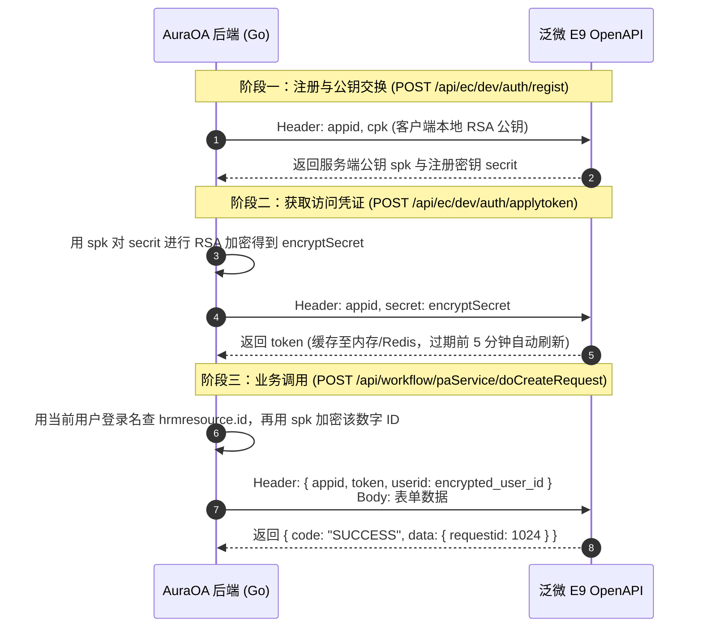

# AuraOA 智能体落地方案与功能全景规范

> **文档版本**：v1.1 (2026-11-02)  
> **文档定位**：三大智能体矩阵分工、泛微 E9 官方原厂接口对接契约、Generative UI 表单交互协议、只读查数安全体系与 Skill 规范指南。

---

## 一、 智能体体系重构与三大角色全景

根据业务演进，原有 `oa_query` 与 `oa_assist` 严重重叠的问题已通过系统级优化解决：**默认关闭 `oa_query`**，系统收敛并演进为**三大专职智能体矩阵**：

```
                    ┌────────────────────────────────────────────────────────┐
                    │               AuraOA 企业智能体工作台                  │
                    └───────────────────────────┬────────────────────────────┘
                                                │
         ┌──────────────────────────────────────┼──────────────────────────────────────┐
         ▼                                      ▼                                      ▼
┌─────────────────────────────────┐   ┌─────────────────────────────────┐   ┌─────────────────────────────────┐
│  【智能体 1】OA 辅助办理助手     │   │  【智能体 2】智能填单与流程创建 │   │   【智能体 3】智能查数分析专家   │
│     (agent_code: oa_assist)     │   │     (agent_code: oa_creator)    │   │     (agent_code: oa_analyst)    │
├─────────────────────────────────┤   ├─────────────────────────────────┤   ├─────────────────────────────────┤
│· 角色定位：                     │   │· 角色定位：                     │   │· 角色定位：                     │
│  已发流程的流转、审核与风控     │   │  新流程的发起、槽位收集与填报   │   │  业务数据深度探索与多维统计分析 │
│· 默认状态：                     │   │· 默认状态：                     │   │· 默认状态：                     │
│  系统默认启用 (Default: ON)     │   │  租户按需装配与使用             │   │  租户按需装配与使用             │
│· 核心能力：                     │   │· 核心能力：                     │   │· 核心能力：                     │
│  - 待办/申请列表检索（下推筛选）│   │  - 业务意图理解与槽位引导追问   │   │  - 自然语言智能转化为 SELECT SQL│
│  - 批量 AI 审核结论与风险点提取 │   │  - Generative UI 响应式表单卡片 │   │  - 五层安全防御与语法白名单拦截 │
│  - 批量流程要点总结提取         │   │  - 用户在卡片内修改、点击确认   │   │  - 自动渲染二维数据表格与趋势   │
│  - 专业审批意见起草 (同意/驳回) │   │  - 泛微官方 doCreateRequest 对接│   │  - 跨部门流程时效、人员负荷分析 │
│  - OA 原生流程办理页一键直达    │   │  - 固定草稿模式，规避联动丢失风险│  - 常用指标数据字典自适配       │
└─────────────────────────────────┘   └─────────────────────────────────┘   └─────────────────────────────────┘
```

---

## 二、 泛微 E9 官方原厂接口对接与安全认证

本方案采用**泛微官方开放平台标准 REST API**，通过租户级基础设施统一鉴权，不再依赖第三方定制插件。

### 1. 认证配置（租户级基础设施，配在 OA 连接配置中）
在 `oa_database_connections` 表扩展 `weaver_app_secret`，租户只需在「系统管理 ➔ OA 连接」中配置一次：
* `weaver_api_url`：泛微 E9 OpenAPI 根地址（如 `http://oa.example.com`）
* `weaver_appid`：泛微后台「集成中心 ➔ 接口安全认证」申请的 AppID
* `weaver_app_secret`：泛微分配的对应密钥（AES 加密存储）
* `weaver_default_user`：兜底工号/登录名（平时直接读取当前登录用户的工号 `user.username`）

### 2. 双向 RSA 握手与 Token 缓存机制（后端通用服务）
后端服务封装 `EcologyOfficialAuthService`，算法对齐泛微官方标准：



### 3. 创建流程接口报文规范（极简版，不含附件）
* **接口地址**：`POST /api/workflow/paService/doCreateRequest`
* **Content-Type**：`application/x-www-form-urlencoded; charset=utf-8`
* **请求头（Header）**：
  * `appid`：`{weaver_appid}`
  * `token`：缓存的有效令牌
  * `userid`：当前用户在 `hrmresource.id` 中的数字 ID，经泛微 `spk` 公钥 RSA 加密后的 Base64 字符串。登录名不能直接加密后传入。
* 创建前必须先调用 `POST /api/workflow/paService/getCreateWorkflowList` 确认该用户能创建目标流程。名称明确时用 `conditions.wfName`，含糊时不传条件查全部可创建流程。未命中则停止，不调用 `get_workflow_schema`。
* **请求体（Form Urlencoded）**：
  * `workflowId`：流程定义 ID（如 `102`）
  * `requestName`：单据标题（规则：`{申请人姓名}+{流程名称}+{YYYY-MM-DD}`）
  * `requestLevel`：`"0"`（正常）
  * `isnextflow`：**`"0"`（固定为 0，创建为草稿状态，申请人点入 OA 确认提交，彻底规避公式与联动不执行的风险）**
  * `mainData`：主表数据 JSON 字符串，例如：`[{"fieldName":"sqr","fieldValue":"1058"},{"fieldName":"reason","fieldValue":"办公文具"}]`
  * `detailData`：明细表数据 JSON 字符串，无明细时固定为 `[]`

---

## 三、 Generative UI 前端交互表单设计

AI 回复不仅是纯文本，而是通过受控的结构化块渲染出**响应式、可编辑、可触发交互的 Ant Design Vue 表单**。

### 0. 协议以系统变量注入（唯一权威来源）

卡片结构说明不再散落在各 skill 与提示词里，而是由 `go-service/internal/service/prompt_ui_protocols.go` 提供两段静态协议，运行时经系统变量展开：

| 系统变量 | 内容 | 典型使用方 |
|----------|------|-----------|
| `{{form_confirm_protocol}}` | `:::form-confirm` 表单确认卡片协议（顶层键、字段类型、明细表、确认闭环） | `oa_creator`，及任何需要生成确认卡片的智能体 |
| `{{chart_protocol}}` | `:::chart` 图表卡片协议（四种类型、categories/series/indicators 结构） | `oa_analyst`，及任何需要出图的智能体 |

约束：

- 其它智能体要出卡片，在系统提示词里直接引用这两个变量即可，**不要复制协议正文**，否则后续改协议会留下多份副本。
- 变量只承载「卡片格式」，不含 E9 表字典、SQL 规范等业务知识——那些属于各 Skill 的正文，按 skill 维度维护。
- Skill 正文经工具回传，**不会**做系统变量替换，因此不要在 `SKILL.md` 里写这两个变量。
- 迁移 `000098` 只更新平台种子智能体的 `system_prompt`，租户自建副本不被覆盖。
- 渲染端（`frontend/utils/chatUiProtocol.ts`）与协议正文必须同步：协议承诺的键渲染端必须支持，渲染端兼容的别名协议里只写推荐值。

### 1. 结构化表单协议 (`:::form-confirm`)

大模型收集齐要素后，在 Markdown 回复末尾输出如下格式块。**顶层键只认下表这些，自造键会被前端静默丢弃**：

| 键 | 必填 | 说明 |
|----|------|------|
| `variant` | 否 | `summary_confirm`（默认）/ `compact_form` / `data_table` |
| `workflow_id` | 否 | 流程定义 ID，如 `"102"` |
| `workflow_name` | 否 | 卡片标题，如 `物品领用申请` |
| `description` | 否 | 卡片说明，展示在标题下方 |
| `fields` | 表单卡片必填 | 字段数组，见下 |
| `details` | 否 | 内嵌只读明细子表 `{title, columns, rows}`，可为数组 |
| `columns` / `rows` | `data_table` 必填 | 只读表格的列与数据，用于查数结果与 CSV 导出 |

`fields` 每项：

| 键 | 必填 | 说明 |
|----|------|------|
| `name` | **是** | OA 真实字段名，必须与 `get_workflow_schema` 返回一致；缺失会导致字段串值、确认后创建草稿失败（前端用 `field_N` 兜底但提交仍不合法） |
| `label` | 是 | 中文显示名 |
| `type` | 否 | `text` / `number` / `date` / `select` / `textarea` / `browser`，缺省 `text` |
| `value` | 否 | 预填值；`date` 用 `YYYY-MM-DD`；`browser` 用存储 ID |
| `display_value` | 否 | `browser` 字段的展示名（人员姓名、部门名称） |
| `options` | `select` 必填 | `[{label, value}]`，也兼容 `["办公文具"]` 字符串数组 |
| `disabled` | 否 | `true` 表示只读 |

````markdown
为您整理了领用申请的预填信息，请确认或修改：

:::form-confirm
{
  "variant": "summary_confirm",
  "workflow_id": "102",
  "workflow_name": "物品领用申请",
  "fields": [
    { "name": "sqr", "label": "申请人", "type": "text", "value": "张三", "disabled": true },
    { "name": "sqrq", "label": "申请日期", "type": "date", "value": "2026-11-02" },
    { "name": "wp_type", "label": "物品类型", "type": "select", "value": "0", "options": [{"label":"办公文具","value":"0"},{"label":"数码配件","value":"1"}] },
    { "name": "reason", "label": "领用用途", "type": "textarea", "value": "部门日常办公文具补充" }
  ],
  "details": { "title": "领用明细", "columns": ["物品名称", "数量"], "rows": [{ "物品名称": "中性笔", "数量": 10 }] }
}
:::
````

块规则：开始/结束标记各自独占一行；块内是裸 JSON，**不要**用三反引号 `json` 代码块包裹；解析失败时前端会提示「卡片数据格式有误」并保留原文，不会静默吞掉。

### 2. 多变体（Variants）视觉适配
* **变体 A：`summary_confirm`（摘要确认型，推荐用于流程创建）**：
  以温润中性灰风格（对齐 AuraOA 主题 `#faf8f5` 底色与 `#ebe5df` 边框）展示键值列表，用户可微调字段，底部提供【确认创建】与【取消】按钮。
* **变体 B：`compact_form`（紧凑表单型）**：
  适合多字段一次性输入的填单向导。
* **变体 C：`data_table`（查数展示型，专供智能体 3）**：
  将 SQL 查询到的结果以响应式只读表格展示，支持按列排序、分页预览与一键导出 CSV。
* **内嵌明细 `details`**：在确认卡片底部追加只读明细子表，适配报销单、采购单等带明细的流程。

### 3. 图表协议 (`:::chart`)

查询结果涉及排行、走势、占比或多维对比时输出。顶层键只认：`type`（`bar` / `line` / `pie` / `radar`）、`title`、`subtitle`、`categories`、`series`、`indicators`、`columns`、`rows`。

- `categories` 是维度名称数组；`series` 每项 `{name, data}`，`data` 与 `categories` 等长且顺序一致。
- `pie` 用 `categories` + 数值 `data`；只给 `[{name,value}]` 时渲染端会兜底拆分，但不推荐。
- `radar` 必须给 `indicators`（**复数**）：`[{name, max}]`，与 `data` 等长；缺 `max` 时前端按数据量级自动补齐。

````markdown
:::chart
{
  "type": "bar",
  "title": "各部门流程发起量 Top5",
  "categories": ["市场部", "研发部", "供应链", "财务部", "人事部"],
  "series": [{ "name": "流程数量", "data": [142, 98, 76, 55, 32] }]
}
:::
````

渲染端对历史写法保持兼容（`xAxis`、单数 `indicator`、`[{name,value}]` 饼图数据、`columns`+`rows` 直接出表），但协议与提示词只写推荐写法。

### 4. 按钮交互闭环（自动注入下轮提示词）
* 用户点击【确认创建】➔ 前端组件捕获最新表单数据，自动向对话流发送：
  `【用户已确认表单】流程ID: 102, 数据: {"sqr":"张三","sqrq":"2026-11-02","wp_type":"文具","reason":"部门日常办公文具补充"}，请立即调用接口创建草稿。`
* 用户点击【取消】➔ 自动发送：
  `【用户已取消表单创建】，不需要提交该流程了。`

---

## 四、 智能体 3（智能查数分析专家）方案与安全体系

很多业务人员和管理者经常需要统计“本月各部门审批耗时分布”、“某人发起了多少流程”、“某类表单金额累计”，智能体 3 专门解决这类**自然语言跨表查数诉求**。

```
用户提问："帮我统计一下上个月市场部一共发起了多少采购流程，总金额是多少？"
                              │
                              ▼
           【智能体 3：智能查数分析专家 (oa_analyst)】
                              │
         ┌────────────────────┴────────────────────┐
         ▼                                         ▼
   结合数据字典 Skill                        调用 execute_safe_query MCP
 (理解物理表: workflow_requestbase,                │
  formtable_main_xx, hrmdepartment)                ▼
                              │            【五层安全守卫拦截器】
                              │          · 词法校验: 仅限 SELECT
                              │          · 表白名单: 屏蔽凭证/敏感表
                              │          · 防线注入: 过滤注释符
                              │          · 保护机制: 按智能体配置限制行数（默认 100，0 为不限制）
                              │                    │
                              └────────────────────┼───────────────────┐
                                                   ▼                   ▼
                                            执行只读 SQL 查询      拦截违规语句
                                                   │
                                                   ▼
                                       返回结构化二维 JSON 数据
                                                   │
                                                   ▼
                                    前端渲染 Generative UI 表格卡片
                                       (variant: data_table)
```

### 1. 安全防御守卫（五层拦截）
1. **词法与 AST 白名单**：
   * 仅允许 `SELECT` 开头；
   * 严禁包含 `INSERT`、`UPDATE`、`DELETE`、`DROP`、`ALTER`、`TRUNCATE`、`EXEC`、`MERGE`、`GRANT`；
   * 严禁包含注释符 `--`、`/*` 拦截注入绕过；
2. **敏感系统表黑名单**：
   * 严格禁止查询包含 `password`、`license`、`token`、`secret`、`key` 的表与字段；
3. **行数强制截断**：
   * 按该智能体的 `max_rows` 包裹行数限制，默认 100；配置为 0 时不截断。一次调用可在 `queries` 中提交多条 SELECT；
4. **数据库驱动级只读**：
   * 连接开启只读事务（`SET TRANSACTION READ ONLY`）。

---

## 五、 开箱即用官方 Skill 指南模板

系统为三大智能体分别预置对应的专属 Skill 模板，方便租户一键复制与参考。

### 模板 1：创建流程 Skill (`skills/workflows/create_supplies_request.md`)
* **关联智能体**：`oa_creator`（流程发起助手）
* **边界**：卡片结构与字段要求以系统变量 `{{form_confirm_protocol}}` 为准；本模板只保留该流程的槽位收集与下拉归类规则，避免协议出现第二份副本。
```markdown
---
name: 办公用品领用申请填报指南
description: 引导员工通过自然语言对话收集领用要素并生成表单确认卡片
agent: oa_creator
---

# 办公用品领用流程 SOP

## 1. 必填字段槽位
向用户逐一引导并收集以下要素：
- 领用物品类别（文具 / 打印耗材 / 数码配件）
- 领用用途说明（不得少于 5 个字）
- 期望领用日期（格式：YYYY-MM-DD）

## 2. 表单确认规则
当上述信息收集完毕后，严禁直接调用接口，必须在回复末尾输出确认卡片：

:::form-confirm
{
  "variant": "summary_confirm",
  "workflow_id": "102",
  "workflow_name": "物品领用申请",
  "fields": [
    { "name": "sqrq", "label": "申请日期", "type": "date", "value": "{期望日期}" },
    { "name": "wp_type", "label": "物品类型", "type": "select", "value": "{物品类别}", "options": ["文具", "打印耗材", "数码配件"] },
    { "name": "reason", "label": "领用用途", "type": "textarea", "value": "{用途说明}" }
  ]
}
:::

## 3. 提交调用
仅当收到用户发送的以【用户已确认表单】开头的消息时，才调用 create_oa_draft 工具提交为草稿。
```

### 模板 2：查数分析 Skill (`skills/data_query/oa_workflow_stats.md`)
* **关联智能体**：`oa_analyst`（智能查数专家）
* **边界**：图表结构与键名以系统变量 `{{chart_protocol}}` 为准；本模板只保留 E9 表字典、查数安全规则与业务口径。
```markdown
---
name: OA 流程与人员统计查数指南
description: 指导大模型根据自然语言生成合规的只读 SELECT SQL
agent: oa_analyst
---

# 泛微 E9 常用数据表结构与查数规范

## 1. 核心业务表字典
- 人员表：`hrmresource`（id: 人员ID, lastname: 姓名, loginid: 工号, departmentid: 部门ID, status: 状态）
- 部门表：`hrmdepartment`（id: 部门ID, departmentname: 部门名称）
- 流程实例表：`workflow_requestbase`（requestid: 流程ID, requestname: 流程标题, workflowid: 流程类型ID, createdate: 创建日期）
- 待办节点表：`workflow_currentoperator`（requestid: 流程ID, userid: 处理人ID, isremark: 0为待办未读）

## 2. 查数原则
- 只能使用 SELECT 语句，严禁跨库或写入。
- 必须带限制条数（如 `LIMIT 20`）。
- 查询张三当前未读待办的 SQL 示例：
  ```sql
  SELECT count(1) AS todo_count 
  FROM workflow_currentoperator o 
  JOIN hrmresource h ON o.userid = h.id 
  WHERE h.lastname = '张三' AND o.isremark IN ('0','1','8','9');
  ```
- 查询部门流程发起排行的 SQL 示例：
  ```sql
  SELECT d.departmentname, count(r.requestid) AS process_count 
  FROM workflow_requestbase r 
  JOIN hrmdepartment d ON r.createrdepartmentid = d.id 
  GROUP BY d.departmentname ORDER BY process_count DESC LIMIT 10;
  ```
```
