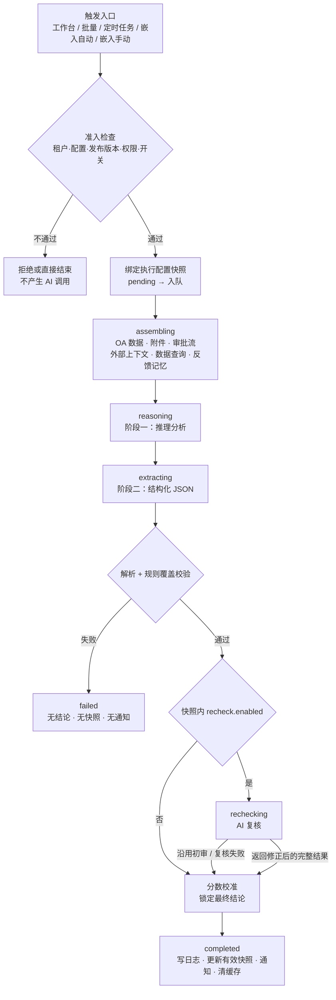
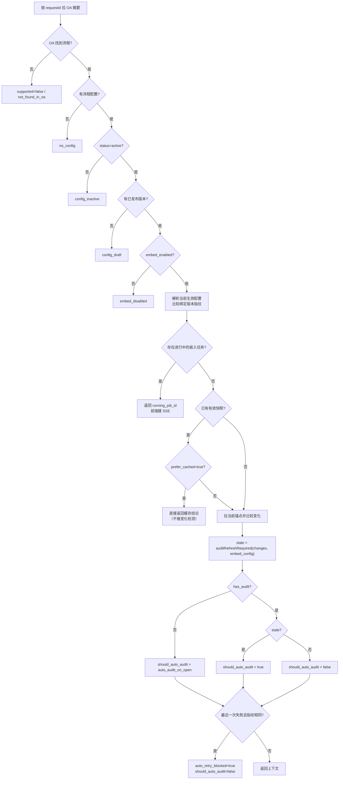
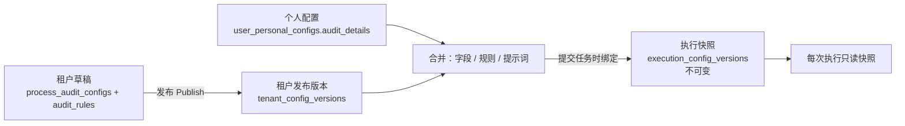
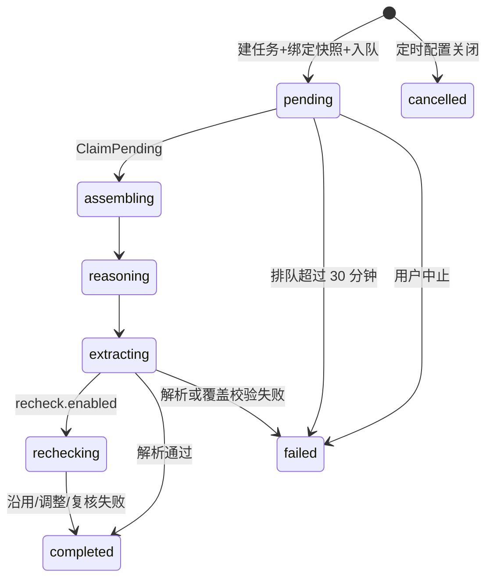

# 审核链路与决策路径（从开关到最终结论）

> 本文描述**代码实际行为**，覆盖审核工作台 `/api/audit` 与 OA 嵌入审核 `/api/embed` 两条入口。
> 归档复盘 `/api/archive` 是对称模块，差异见 [§10](#10-与归档复盘的对称关系)。
> 与接口文档冲突时以代码为准，并回头修订接口文档（见 [`AGENTS.md`](../AGENTS.md) §6.3）。

相关文档：[两阶段审核与评分](./ai-integration.md) · [审核接口](./api/audit.md) · [审核配置接口](./api/audit-config.md) · [OA 嵌入接口](./api/embed.md) · [执行配置版本](./api/execution-config.md) · [规则数据查询](./api/audit-data-queries.md) · [评论反馈记忆](./api/feedback-memory.md)

---

## 0. 十秒版本

| 问题 | 一句话答案 | 章节 |
|------|-----------|------|
| 什么时候会跑？ | 任一入口被触发，且租户 / 配置 / 发布版本 / 权限 / 入口开关全部放行 | §2 |
| 拿什么审？ | 已发布配置 → 叠加个人配置 → 固化为不可变执行快照 | §3 |
| 怎么审？ | 两阶段（推理 → 结构化提取），可选第三次 AI 复核 | §4、§5.3 |
| 结论谁定？ | 程序按**分数区间**校准；模型写的结论不直接生效 | §5.2 |
| 结果去哪？ | `audit_logs` + 有效快照 + 通知 + 缓存失效；**不回写 OA** | §5.5、§6 |

三条最容易踩的认知偏差：

1. **结论 = 分数**：`≥80 approve`、`60–79 review`、`<60 return`。模型输出的 `recommendation` 只用于判断合法性（能否归一化为这三个值之一），最终值由 `CalibrateAuditRecommendationByScore` 重算。
2. **草稿不执行**：执行只读取"当前激活的发布版本"；新保存但未发布的修改不影响任何执行，也不会触发已绑定流程重审。
3. **默认重审沿用旧快照**：同一流程再次审核默认复用首次绑定的执行配置；只有显式"使用最新配置重新审核"才重新绑定（嵌入页还受 `allow_latest_config_rerun` 限制）。

---

## 1. 路径总图



三个阶段的对象不同，不要混：

| 阶段 | 决定的东西 | 产物 |
|------|-----------|------|
| 准入 | 这次任务能不能跑 | 一个 `pending` 任务，或直接拒绝 |
| 配置解析 | 这次拿什么材料、什么规则、什么提示词去跑 | `execution_config_versions` 不可变快照 |
| 结果校验 | 跑出来的东西能不能作为业务结论 | `audit_logs` + `audit_process_snapshots` |

---

## 2. 准入：任务会不会真的跑

### 2.1 所有入口共用的检查

| # | 检查 | 位置 | 不满足时的表现 |
|---|------|------|---------------|
| 1 | 身份与租户上下文（JWT 或嵌入令牌） | `middleware.JWT` / `middleware.EmbedAccess` | 401 |
| 2 | 嵌入令牌对应的租户 `status=active`、`embed_enabled=true`、已配置管理员 | [`embed_access.go`](../go-service/internal/middleware/embed_access.go) | 401 / 403 |
| 3 | 租户已配置主用 AI 模型且模型存在 | `createPendingAuditLog` | 报错，不创建任务 |
| 4 | 按 `process_type` 找到审核配置 | `getProcessConfigCached` | 报错「审核配置不存在」 |
| 5 | 配置 `status=active` | `createPendingAuditLog` | 报错「审核配置已停用」 |
| 6 | 存在已发布的基础版本（首次执行或强制重绑时） | `GetActiveBaseVersion` | 报错「配置尚处于草稿状态，请先发布首个版本」 |
| 7 | 工作台/批量入口：当前组织成员命中 `access_control` | `accessControlAllows` | 报错「当前用户无权执行该审核流程」 |
| 8 | 嵌入触发时该流程 `embed_enabled=true` | `validateEmbedTrigger` | 403 |
| 9 | Redis 可用（异步入口必需） | `Execute` | 报错，不创建任务 |

> `access_control` 语义：`allow_all=true` 时全员可执行；否则 `allowed_roles` / `allowed_members` / `allowed_departments` **任一命中**即通过；三类全空时**默认拒绝**，`tenant_admin` 不会自动绕过（见 [`access_control.go`](../go-service/internal/service/access_control.go)）。
> `access_control` 只约束工作台/批量入口。OA 嵌入由租户/流程 `embed_enabled` 与 OA 页面可见性控制，标准视角的执行身份是租户管理员，不再套用该名单（个人视角按实际 OA 操作人执行）。

### 2.2 入口矩阵

| 入口 | 接口 | 服务方法 | `trigger_source` | `trigger_detail` | 队列 | 执行方式 |
|------|------|---------|------------------|------------------|------|---------|
| 工作台单条 | `POST /api/audit/execute` | `Execute` | `workbench_manual`（服务端固定） | 空 | `workbench` | 异步，入 Redis Stream |
| 工作台批量 | `POST /api/audit/batch` | `BatchExecute` | `workbench_batch`（服务端固定） | 空 | `workbench` | 同步逐条，上限 10 |
| 定时任务 | Cron `audit_batch` | `CronTaskService.runAuditBatch` → `BatchExecute` | `workbench_batch` | 空 | `workbench` | 同步逐条 |
| 嵌入自动 | `POST /api/embed/execute` | `ExecuteEmbed` → `Execute` | `embed_auto` | `visible_open` / `form_open` / `save_requested` / `submit_requested` / `scheduled_scan` | `interactive` / `background` / `scheduled` | 异步 |
| 嵌入手动 | `POST /api/embed/execute` | `ExecuteEmbed` → `Execute` | `embed_manual` | 强制 `manual` | `interactive` | 异步 |
| 嵌入个人视角 | `POST /api/embed/execute`（`perspective=personal`） | `ExecuteEmbed` → `Execute` | `workbench_manual` | `personal_embed_manual` | `interactive` | 异步 |
| 智能体工具 | 对话内 `run_audit` | `Execute` | `workbench_manual` | 空 | `workbench` | 异步（先做 OA 可见性校验） |
| 复核重试 | `POST /api/embed/jobs/:id/recheck` | `RetryRecheck` | 沿用原任务 | 沿用原任务 | 嵌入任务 → `interactive` | 异步，只重跑复核 |

关键细节：

- **触发源由入口在服务端固定**：`trigger_source` / `trigger_detail` 字段为 `json:"-"`，请求体无法伪造；工作台单条固定 `workbench_manual`，批量固定 `workbench_batch`，嵌入与个人视角在服务内部设置。队列由二者推导（`normalizeAuditTriggerDetail`），自动审核未带明细时按"可见嵌入页打开"处理（`visible_open` + `interactive`）。
- **个人视角先换执行人再换触发源**：先解析 OA 操作人 → `user_id` 改为该用户 → 触发源改为 `workbench_manual` + `personal_embed_manual`，并强制 `use_latest_config=true`。因此个人视角**不受** `should_auto_audit` 门禁约束。
- **定时任务当前记为 `workbench_batch`**：`runAuditBatch` 未设置 `trigger_source`，由 `BatchExecute` 补默认值。`cron_scheduled` 常量存在且被入口白名单接受，但当前代码没有生成它的调用点。
- 同一流程重复提交：嵌入入口用 Redis 锁 + "进行中任务"查询去重；若已有 `pending` 任务且本次是交互队列/手动触发，会把该任务**升级为交互队列并改标签**后直接返回，不新建任务。

### 2.3 嵌入页"是否自动审"的完整判定

`GetEmbedContext` 是自动审核的唯一决策点（`ExecuteEmbed` 会自动再调一次做门禁）：



变化指纹 → 开关的映射（`auditRefreshRequired`）：

| 变化类型 | 判定来源 | 生效开关 | 默认 |
|---------|---------|---------|------|
| 业务数据 / 附件版本变化 | `DataChanged` / `AttachmentChanged` | `auto_audit_on_data_change` | `true` |
| 退回、退回后重新提交 | `ReturnResubmitChanged` | `auto_audit_on_return_resubmit` | `true` |
| 普通节点推进 / 审批流变化 | `FlowChanged` / `CurrentNodeChanged` | `auto_audit_on_flow_change` | `false` |
| 只有旧版锚点、无法细分 | `LegacyAnchor` | 仅 `auto_audit_on_data_change` | `true` |
| 执行配置版本变化 | `ExecutionConfigChanged` | **不触发自动审核**（历史结果无可恢复快照时，还会把数据/附件变化清零，避免"配置变化"被误判为"业务数据变化"） | — |
| `auto_audit_on_stale` | — | **已废弃，不参与任何决策**（仅为兼容旧配置保留字段） | — |

补充规则：

- **"首次打开"和"过期刷新"是两条路径**：无历史结果时才看 `auto_audit_on_open`；有历史结果时只由变化指纹决定。
- **`auto_retry_blocked`**：最近一次任务 `failed`、且其 `attempt_fingerprint` 等于当前指纹，说明"同数据同规则已经失败过"，不再自动重试，前端提示手动重审。
- **"最新配置重审"不是自动行为**：配置升级只给出 `config_upgrade_available`，用户手动选择后才带 `use_latest_config=true`，且要求 `allow_latest_config_rerun=true`（否则 403）。

### 2.4 定时扫描（后台自动发现）

| 开关 | 默认 | 作用 |
|------|------|------|
| `scheduled_refresh_enabled` | `false` | 是否为该流程注册定时扫描；保存配置即同步调度，关闭立即移除 Cron |
| `scheduled_refresh_lookback_days` | `3`（范围 1–30） | 只扫描近 N 天创建的实例 |
| `scheduled_refresh_interval_minutes` | `5`（5/10/15/30/60） | 扫描频率 |
| 配置 `status=active` + `embed_enabled=true` | — | 调度生效的前置条件；执行前会再次核验 |

流程：Cron 触发 → 扫描近期实例（单次最多 500 个候选）→ 逐条 `GetEmbedContext` → `should_auto_audit=true` 才 `ExecuteEmbed`（`embed_auto` + `scheduled_scan`）→ 指纹未变化则不产生任何任务与 LLM 日志。

### 2.5 定时任务（显式批量审待办）

`audit_batch` 任务以**任务归属用户**的 OA 待办为数据源（`ListPendingForBatch`）：

1. 按 `date_range` 限定提交时间；
2. 只保留当前用户有权访问、`status=active` 的配置对应的主表名 + 流程类型（AND）；
3. `workflow_ids` 非空时再按流程 ID / 流程类型过滤；
4. 已有有效快照的流程跳过（视为已处理）；
5. 单次上限取 `cron_task_configs.batch_limit`，默认 10；
6. 逐条同步执行，支持中途中止。

---

## 3. 配置解析：这次"拿什么审"

### 3.1 三层配置与一次冻结



| 层 | 内容 | 何时生效 |
|----|------|---------|
| 草稿 | 管理员编辑中的配置 | **不参与执行**；发布后才可能被绑定 |
| 发布版本 | 不可变的基础配置（`base_config_version`） | 首次执行绑定、或显式"使用最新配置"时 |
| 个人配置 | 字段追加、规则开关、私有规则、审核尺度 | 在租户允许的权限内叠加到发布版本上 |
| 执行快照 | 最终 `ai_config` / `field_set` / `merged_rules` / `effective_rules` | 绑定后固定；默认重审沿用 |

绑定作用域（`scope`）：

- 标准视角：`scope=""`（租户/嵌入通用）
- 个人视角：`scope="user:<user_id>"`

所以同一流程可以同时存在"通用绑定"和"某人的个人绑定"，互不覆盖。

### 3.2 字段范围

| 开关 | 默认 | 行为 |
|------|------|------|
| `field_mode` | `all` | `all`：全字段（`field_set=nil`）；`selected`：只传勾选字段 |
| 字段 `selected` | — | 仅在 `selected` 模式下生效 |
| `user_permissions.allow_custom_fields` | `false`（`{}` 视为全关） | 允许用户 `field_overrides` 追加字段；只能追加租户仍存在的字段 |
| `skip_empty_fields` | `false` | 统一空值策略：`null` / 空串 / 纯空白不传；`0`、`false` 正常传 |
| `skip_empty_field_keys` | `[]` | 单字段空值策略（`main:字段`、`明细表:字段`），统一开关开启时被覆盖 |

注意：

- 空值过滤只作用于**提示词副本**，不改变 OA 数据、业务快照和数据变化指纹。
- **附件范围跟随字段范围**：`field_mode=all` 才识别全部主表附件；`selected` 模式只下载并解析选中附件字段的附件，未选中的附件不会调用解析服务。
- 附件内容还受系统级 `attachment.recognition_enabled`（默认 `false`）控制；关闭时附件正文为空，只保留占位提示。
- 个人配置只保存 `field_overrides`（追加字段），字段传输模式完全由租户 `field_mode` 决定，避免个人切换模式导致字段范围意外收窄。

### 3.3 规则生效

| 规则属性 | 语义 | 是否受个人配置影响 |
|---------|------|-------------------|
| `enabled`（为 `nil` 视为 `true`） | 租户侧启停 | 可被用户 toggle 覆盖 |
| `rule_scope=mandatory` | 强制执行 | **不可**关闭；即使租户侧 `enabled=false`，执行时仍被强制启用 |
| `rule_scope=default_on` | 默认开启 | 可被用户 toggle 关闭 |
| `rule_scope=default_off` | 默认关闭 | 可被用户 toggle 开启（导入时默认 `enabled=false`） |
| `applicability_condition` | 适用前提 | 与正文成组送入模型；前提不满足时该规则直接 `passed=true` 且不扣分 |
| `context_enabled` + `context_mounts` | 规则级外部关联数据 | 仅启用规则、且配置了挂载时才查询 |
| `data_queries` | 规则级数据查询 | 与规则一起执行，证据写入 `query_evidence` |
| `related_flow` | 关联审批流 | 决定是否需要审批流快照：提示词引用审批流/当前节点，或存在启用的关联规则时才拉取；失败不阻塞 |

合并优先级：`mandatory`（强制开） > 用户 toggle > 租户 `enabled`。
`allow_custom_rules=false` 时，已保存的 `rule_toggle_overrides` 与 `custom_rules` 一并失效；设置页锁定租户规则开关，保存时保留原配置以便权限恢复后继续使用。
用户私有规则（`custom_rules`）只在 `allow_custom_rules=true` 且单条 `enabled=true` 时追加，排在租户规则之后。

规则文本格式：`N. 规则内容：…`，有前提时换行 `   适用前提：…`；`rule_scope` 不送入模型。规则结果回显时会剥离可能残留的作用域前缀（`[default_on]`、`（默认开启）` 等）。

### 3.4 提示词与审核尺度

| 开关 | 默认 | 行为 |
|------|------|------|
| `ai_config.audit_strictness` | `standard` | `strict` / `standard` / `loose`，决定使用哪套系统模板 |
| `user_permissions.allow_modify_strictness` | `false` | 允许个人用 `strictness_override` 覆盖 |
| `ai_config.enable_thinking` | `false` | 且模型需 `supports_thinking=true` 才真正开启 |
| `system_reasoning_prompt` / `user_reasoning_prompt` | 来自系统模板 | 可编辑；保存时按提交内容原样保留 |
| `system_extraction_prompt` / `user_extraction_prompt` | 来自系统模板 | **保存时被服务端按尺度覆盖（锁定）**，防止破坏 JSON Schema |

个人尺度切换的是**整套四段提示词**（reasoning/extraction × system/user），而不是只改一个字段；同时保留租户的空值传输策略与 `enable_thinking`。`ai_config.audit_strictness` 单独变化不视为生效。若复核系统提示词仍是旧尺度的默认值，会同步切换为新尺度默认值；管理员自定义过的复核提示词保持不变。

提示词构建时还会：

- 推理阶段补齐缺失占位符：`{{rules}}`、`{{attachments}}`、`{{external_context}}` 未出现时追加（提取阶段只补 `{{rules}}`）；
- 追加统一"规则适用前提"说明（提示词中已有则不重复）；
- 展开系统变量 `{{current_date}}` / `{{current_time}}` / `{{current_datetime}}` / `{{weekday}}`；
- 追加当前租户、模块、流程类型下**已启用且已发布**的反馈记忆（无开关，发布即生效；冲突以正式规则为准）。

### 3.5 模型参数

| 项 | 来源 | 说明 |
|----|------|------|
| 主模型 | 租户 `primary_model_id` | 缺失直接报错 |
| 备用模型 | 租户 `fallback_model_id` | 与主模型路由相同时不使用 |
| 重试次数 | 系统配置 `system.ai_retry_count`（默认 3） | 主模型指数退避重试；仍失败再切备用模型重试 |
| 温度 | 租户 `temperature`（默认 0.30） | 推理阶段使用；提取阶段固定 `0.1` |
| 单次上限 Token | 租户 `max_tokens_per_request`（默认 8192） | 推理、提取、复核共用 |
| 思考 | `supports_thinking && enable_thinking` | 个人尺度只切换提示词，不改变租户的深度思考设置 |

调用统一走 `AIModelCallerService.ChatWithFallback`：主模型重试 → 备用模型 → 仍失败则任务失败；推理阶段做配额预扣，提取阶段 `SkipQuotaCheck=true`（与推理共享配额）。

### 3.6 上下文与外部数据

| 来源 | 开关 / 条件 | 失败时 |
|------|------------|--------|
| 审批流历史 + 路由图 | 提示词引用审批流/当前节点，或存在 `related_flow` 的启用规则 | 返回 nil，不阻塞，提示词用占位文本 |
| 规则外部关联 | 规则 `enabled && context_enabled && context_mounts 非空` | 无数据不注入；查询异常以提示文本进入上下文 |
| 规则数据查询 | 规则 `data_queries` | 失败/截断信息作为证据交给 AI 判断，**不强制降分或改判** |
| 反馈记忆 | 记忆 `enabled` + 已发布版本 | 读取失败直接任务失败（不静默忽略） |
| 数据脱敏 | 系统开关 `system.enable_data_encryption` | 开启时对数据、快照、外部上下文、记忆、AI 输出、复核文本做脱敏 |

### 3.7 版本绑定开关

| 场景 | 行为 |
|------|------|
| 默认（`use_latest_config=false`） | 先查该流程 + 作用域的既有绑定；有则复用，无则用当前激活发布版本创建绑定 |
| `use_latest_config=true` | 跳过复用，按当前激活发布版本强制重新绑定（`force=true`） |
| 工作台 | 无额外权限限制，用户主动点"使用最新配置重新审核"即可 |
| 嵌入页 | 需要 `embed_config.allow_latest_config_rerun=true`，否则 403 |
| 个人视角 | 强制 `use_latest_config=true`，不受上述开关限制 |

快照内容固定为：`ai_config`、`field_set`、`merged_rules`、`effective_rules`、`base_config_version_no`、`personal_config_version_no`。任务创建时同时按快照中的 `recheck.enabled` 预置进度条（`ai_recheck={"enabled":true}`）。

---

## 4. 执行链路

### 4.1 状态机

| 状态 | 含义 | 是否终态 |
|------|------|---------|
| `pending` | 已建任务、等待被 Worker 领取 | 否 |
| `assembling` | 已领取，正在拉取并组装材料 | 否 |
| `reasoning` | 阶段一推理中 | 否 |
| `extracting` | 阶段二结构化提取中 | 否 |
| `rechecking` | AI 复核中（仅开启复核时） | 否 |
| `completed` | 有可用结论 | 是 |
| `failed` | 执行失败、解析失败、超时或用户中止 | 是 |
| `cancelled` | 未领取的定时任务被配置关闭取消 | 是 |



关键约束：

- `ClaimPending` 只在 `status=pending AND queue_kind=当前队列` 时把任务置为 `assembling`，重复消费不会重跑。
- 后续每次写状态都带 `status IN (pending/assembling/reasoning/extracting/rechecking)`（`updateAuditLogIfNotCancelled`），终态不会被迟到结果覆盖；用户中止后同样不会被覆盖。
- 单任务 `context` 上限 **25 分钟**（`auditProcessTimeout`）；排队/执行超过 **30 分钟**（`auditJobMaxAge`）由对账任务标记失败（`FailStaleAuditJobs`，默认每 30 秒 + 每次列表查询时触发）。
- 取消任务写入 `failed` + `已主动中止`（不是 `cancelled`），并 cancel 执行上下文。
- AI 配额不足、API Key 解密失败、OA 查询失败、反馈记忆读取失败都会使任务 `failed`（原因写入 `error_message`），不产生任何业务结论。
- 四类队列独立并发（workbench / interactive / background / scheduled），共享总并发限制。

### 4.2 各阶段落库

| 阶段 | 写入字段 |
|------|---------|
| 建任务 | `status=pending`、`trigger_source/detail`、`queue_kind`、`config_version_id/no`、`ai_recheck`、`attempt_fingerprint` |
| 组装 | `status=assembling`；随后 `query_evidence`、`oa_context_anchor`、`attempt_fingerprint` |
| 推理 | `status=reasoning`；完成后 `ai_reasoning`、`deep_thinking` |
| 提取 | `status=extracting`；完成后 `raw_content`、`duration_ms` |
| 复核 | `status=rechecking`、`ai_recheck`（含初审与最终结果） |
| 结束 | `status`、`recommendation`、`score`、`confidence`、`audit_result`、`error_message` / `parse_error` |

### 4.3 一次审核的完整时序

以"用户在嵌入页打开流程"为例，实际调用顺序如下（工作台只是入口与队列不同）：

1. 前端 `GET /api/embed/context` → `GetEmbedContext` 返回 `should_auto_audit`。
2. 前端 `POST /api/embed/execute`（`embed_auto`）→ `ExecuteEmbed`。
3. 进程内去重锁 → 查询进行中任务 → 再取一次上下文做门禁（`should_auto_audit`）。
4. `Execute` → `createPendingAuditLog`：租户/模型/配置/发布版本/访问控制/嵌入开关逐项校验。
5. `resolveUserConfig` + `BindSnapshot`：合并发布版本与个人配置，写入不可变执行快照。
6. 插入 `audit_logs`（`pending`；按快照 `recheck.enabled` 预置 `ai_recheck`）→ `EnqueueAuditJob` 写入对应队列 → 返回 202 与任务 ID。
7. Worker `XReadGroup` → 必要时转投队列 → 并发名额 → `processAuditJob`。
8. `ClaimPending`（`pending → assembling`）→ 30 分钟排队检查 → 建立 25 分钟执行上下文。
9. 读取绑定快照、解密 API Key、准备备用模型；若任务是复核重试（`retry_only`）则直接进入复核分支。
10. `fetchOAData` → 附件 → 审批流快照 → 规则外部关联 → 规则数据查询 → 反馈记忆 → 脱敏。
11. `BuildReasoningPrompt` → `ChatWithFallback`（`reasoning`）→ 落库分析与思考。
12. `BuildExtractionPrompt` → `ChatWithFallback`（`extracting`，温度 0.1，跳过配额预扣）→ 落库原始输出。
13. `ParseAuditResult` + `validateAuditRuleCoverage`。
14. 若快照开启复核：`runAIRecheck` → 校验 → 变化比较 → `rechecking` 落库。
15. 按已校准的解析结果写终态 → 更新有效快照 → 通知 → 缓存失效。
16. 前端 SSE/轮询看到 `completed`，用 `audit_result` 展示结论与逐条规则。

---

## 5. 结果校验与最终决策

### 5.1 硬校验（不通过即任务失败）

对提取阶段（以及复核返回的最终结果）执行同一套校验：

| 校验 | 规则 |
|------|------|
| JSON 对象 | 必须是有效 JSON 对象且非空 |
| `overall_score` / `confidence` | 必须是 0–100 的数值；显式 0 可以保留，缺失不算 0 |
| `recommendation` | 非空，可归一化为 `approve` / `return` / `review`（支持中英文别名） |
| `rule_results` | 数组；每项须有 `rule_content`（非空）、`passed`（布尔且显式存在）、`reason`（字符串） |
| `risk_points` / `suggestions` | 数组，元素必须是字符串（可为空数组） |
| 规则覆盖 | 本次**启用**的每条规则都必须在结果中出现 |

补充：

- 覆盖匹配忽略作用域前缀和 Unicode 空白，但**保留文字、标点和重复条目数量**；个人规则可以额外出现，租户启用规则不能被遗漏或合并。
- 若分数 < 100 且风险与建议都为空，会自动从 `deductions` 或未通过规则中补出风险点（仅补展示，不改分）。
- 任何校验失败 → `status=failed`、`parse_error`、结论/分数/置信度归零、`audit_result={}`，并且**不进入复核**、不更新有效快照、不发完成通知。

### 5.2 结论校准（真正的"最终决策"）

```go
// CalibrateAuditRecommendationByScore
score >= 80 → "approve"
score >= 60 → "review"
else        → "return"
```

| 模型原始输出 | 分数 | 最终结论 |
|-------------|------|---------|
| `approve` | 92 | `approve` |
| `approve` | 71 | `review`（按分数改判） |
| `return` | 85 | `approve`（按分数改判） |
| `review` | 45 | `return` |

> 换言之：**分数是唯一事实来源，模型结论只是被校验的标签**。复核阶段同样适用这条规则，且复核结果必须自洽：`recommendation` 必须等于按 `overall_score` 校准出的值，否则复核被判定失败。

需要注意：分数本身由模型按提示词中的评分口径给出（见 [问题定性与评分](./ai-integration.md#问题定性与评分)），程序**不校验**"规则未通过却给高分"这类语义矛盾，只校验结构、覆盖和区间。若需要更强的自洽约束，应开启 AI 复核（复核提示词专门核对分数与结论、通过与理由的一致性）。

### 5.3 AI 复核（可选第三阶段）

| 项 | 说明 |
|----|------|
| 开关 | 执行快照里的 `ai_config.recheck.enabled`（默认关闭；保存配置时补齐默认提示词，但不会给旧快照自动开启） |
| 输入 | 本次绑定规则 + 初审结构化结果；`{{reasoning_result}}`、`{{audit_context}}`、`{{original_system_prompt}}` 仅在模板显式引用时传入 |
| 调用 | `call_type=recheck`，温度 0.1，共用主/备模型与配额，关联同一 `business_log_id` |
| 输出协议 | 无需修改返回 `{"reuse_original":true}`；需要修改返回 `reuse_original=false` + `reason` + 完整 `final_result` |
| 额外校验 | 字段不得缺失；结论与分数区间一致；规则条数与名称不得增删；`deductions` 合计须等于 `100-score`；最终结果必须再次通过 §5.1 |
| 变更判定 | 按业务内容比较（忽略键序、条目顺序、纯空白），实际变化才标记 `changed=true` |
| 失败处理 | 调用失败 / 空响应 / 结构或覆盖校验失败 → **采用初审**，任务仍 `completed`，`ai_recheck.status=failed` + `reuse_original=true` |
| 取消/超时 | 取消 → 任务失败；复核阶段超时 → 复核标记失败、沿用初审完成；迟到响应不覆盖终态 |
| 重试 | `POST /api/embed/jobs/:id/recheck` 仅重跑复核（不重读 OA、不重跑推理），要求原任务留有失败记录、原绑定版本开启复核、初审完整且覆盖规则 |

### 5.4 终态矩阵

| 触发情况 | `status` | 结论/分数 | 有效快照 | 完成通知 |
|---------|----------|----------|---------|---------|
| 解析通过（无复核或复核沿用/调整） | `completed` | 校准后结论 | 更新 | 非嵌入触发才发 |
| 解析失败 / 覆盖校验失败 | `failed` | 空 / 0 | 不更新（保留历史） | 不发 |
| 复核失败（结构、调用、空响应） | `completed` | 初审结论 | 更新 | 非嵌入触发才发 |
| 任务执行超时 | `failed` | 空 / 0 | 不更新 | 不发 |
| 用户中止 | `failed` + `已主动中止` | 空 / 0 | 不更新 | 不发 |
| 定时待执行任务被配置关闭取消 | `cancelled` | 空 / 0 | 不更新 | 不发 |
| 个人视角（`personal_embed_manual`） | `completed` | 校准后结论 | **不写共享快照**（仅个人记录） | 发给该个人用户（触发源为 `workbench_manual`） |

### 5.5 结果去向

1. **`audit_logs`**：一次执行一条，保留原始推理、思考、结构化结果、复核记录与配置版本。
2. **`audit_process_snapshots`**：仅成功结果进入 `valid_log_ids` 链并成为 `latest_valid_log_id`；渠道由触发源决定（`workbench` / `embed`），个人视角不写。
3. **通知**：非嵌入触发的成功任务给执行人发站内通知（`/workbench?processId=…`）。
4. **缓存失效**：待办、快照、统计、OA 数据缓存同时失效。
5. **审核链**：`GET /api/audit/chain/:processId` 按权限返回个人记录 + 通用嵌入记录；租户管理员在前台**没有**额外特权。

### 5.6 只读边界

审核链路只读取 OA 数据（流程、字段、附件、审批流、锚点），**不调用任何审批、退回、批注写回接口**。`approve` / `review` / `return` 是呈现给审批人的建议，落地与否由人在 OA 中决定。

### 5.7 工作台与嵌入页如何呈现

| 位置 | 判定 | 说明 |
|------|------|------|
| 工作台「待 AI」 | 无有效快照 | 有失败记录但无历史快照仍归此类，不展示为"退回" |
| 工作台「AI 已审核」 | 有有效快照 | 展示快照对应的最新有效日志 |
| 工作台「全部已完成」 | 不在当前 OA 待办中，且存在有效快照 | 按快照 `updated_at` 排序 |
| 状态筛选（通过/复核/退回） | 结果里的 `recommendation` | 只对这个字段做等值过滤 |
| 进行中状态 | `pending` / `assembling` / `reasoning` / `extracting` / `rechecking` | 覆盖展示当前任务的进度，不改变"已审核"归属 |
| 嵌入页结论 | 通用渠道 `embed` 快照 + 个人记录 | 有进行中任务时优先展示任务进度 |

"有效快照"只看成功解析的日志链；解析失败、取消、个人视角都不会改变它。
失败任务的进度按实际停下的阶段标记（组装 / 推理 / 提取 / 复核），不会因为"配置了复核"就把早期失败标成复核失败。

---

## 6. 开关全景表

> "层级"：系统 = 平台管理员；租户 = 租户管理员；个人 = 业务用户；请求 = 调用参数。

| 开关 | 默认 | 层级 | 决定什么 |
|------|------|------|---------|
| `tenant.embed_enabled` | `false` | 系统 | 嵌入入口是否可用 |
| `tenant.primary_model_id` / `fallback_model_id` | — | 系统 | 审核所用模型与降级路由 |
| `tenant.temperature` / `max_tokens_per_request` | `0.30` / `8192` | 系统 | 推理温度与单次上限 |
| `system.enable_data_encryption` | `false` | 系统 | 全链路脱敏 |
| `attachment.recognition_enabled` | `false` | 系统 | 是否解析附件正文 |
| 配置 `status` | `active` | 租户 | 配置是否可用（列表/嵌入/定时与直接执行入口统一校验） |
| 配置发布版本 | — | 租户 | 首次执行 / 强制重绑必须有激活版本 |
| `access_control.*` | 全拒绝 | 租户 | 谁能从工作台/批量入口执行该流程审核（嵌入不套用） |
| `field_mode` | `all` | 租户 | 送审字段范围 |
| 字段 `selected` | — | 租户 | `selected` 模式下具体字段 |
| `user_permissions.allow_custom_fields` | `false` | 租户 | 个人能否追加字段 |
| `user_permissions.allow_custom_rules` | `false` | 租户 | 个人能否新增规则并覆盖租户规则开关 |
| `user_permissions.allow_modify_strictness` | `false` | 租户 | 个人能否改审核尺度 |
| 规则 `enabled` / `rule_scope` | `true` / `default_on` | 租户 | 规则是否参与审核 |
| 规则 `applicability_condition` | 空 | 租户 | 规则适用前提 |
| 规则 `context_enabled` + `context_mounts` | `false` / `[]` | 租户 | 外部关联数据 |
| 规则 `data_queries` | `[]` | 租户 | 规则级数据查询 |
| `ai_config.audit_strictness` | `standard` | 租户 | 提示词尺度 |
| `ai_config.enable_thinking` | `false` | 租户 | 深度思考（需模型支持） |
| `ai_config.skip_empty_fields` / `skip_empty_field_keys` | `false` / `[]` | 租户 | 空值传输策略 |
| `ai_config.recheck.enabled` | `false` | 租户 | 是否增加 AI 复核 |
| 反馈记忆 `enabled` + 已发布版本 | — | 租户 | 是否把已发布反馈记忆追加到推理提示词 |
| `embed_config.auto_audit_on_open` | `true` | 租户 | 无历史结果时自动审 |
| `embed_config.auto_audit_on_data_change` | `true` | 租户 | 数据/附件变化后自动审 |
| `embed_config.auto_audit_on_return_resubmit` | `true` | 租户 | 退回/重提后自动审 |
| `embed_config.auto_audit_on_flow_change` | `false` | 租户 | 普通推进后自动审 |
| `embed_config.scheduled_refresh_enabled` | `false` | 租户 | 定时扫描近期流程 |
| `embed_config.scheduled_refresh_lookback_days` / `_interval_minutes` | `3` / `5` | 租户 | 扫描范围与频率 |
| `embed_config.allow_latest_config_rerun` | `false` | 租户 | 嵌入页能否用最新配置重审 |
| `embed_config.auto_audit_on_stale` | — | — | **已废弃**，不参与决策 |
| `kb_mode` | `rules_only` | 租户 | 仅存储/展示，RAG 未实现 |
| 个人 `strictness_override` | 空 | 个人 | 覆盖审核尺度（需权限） |
| 个人 `rule_toggle_overrides` | `[]` | 个人 | 覆盖租户规则开关（mandatory 除外） |
| 个人 `custom_rules` | `[]` | 个人 | 追加私有规则（需权限） |
| 个人 `field_overrides` | `[]` | 个人 | 追加字段（需权限） |
| `perspective` | `standard` | 请求 | 个人视角 / 标准视角、绑定作用域与执行人 |
| `use_latest_config` | `false` | 请求 | 复用旧快照还是重新绑定 |
| `trigger_source` / `trigger_detail` | — | 服务端 | 队列、快照渠道、通知、自动审核门禁；不接受请求体覆盖 |
| `prefer_cached` | `false` | 请求 | 有结论时跳过变化检测（嵌入页首屏优化） |
| Cron `enabled` / `batch_limit` / `date_range` / `workflow_ids` | — | 租户 | 定时批量审核的范围与条数 |

---

## 7. 现象 → 定位

| 现象 | 优先检查 |
|------|---------|
| 嵌入页不自动审 | `embed_enabled`（流程与租户两级）→ `status` → 发布版本 → `should_auto_audit` → `auto_retry_blocked` → 对应变化开关 |
| 有结果但仍提示"信息有变化" | `stale` 为真：检查数据/附件指纹、退回重提、节点变化；`field_mode` 改变也会改变指纹 |
| 配置改了但重审结果没变 | 默认复用旧绑定；确认是否点了"使用最新配置"，或 `allow_latest_config_rerun` 是否为 `false` |
| 规则没生效 | `enabled`、`rule_scope`、个人 toggle、`allow_custom_rules`；`mandatory` 是否被误以为可关闭 |
| 任务失败且 `parse_error` 有值 | 看 §5.1 具体校验项，尤其是规则覆盖（是否漏了某条启用规则） |
| 复核失败但任务 `completed` | 预期行为：采用初审，`ai_recheck.status=failed` |
| 任务卡在 `pending` | Redis/Worker 是否启动、`auditJobMaxAge` 是否已超时、队列是否被转投失败 |
| 定时扫描没有任务 | `scheduled_refresh_enabled`、`status`、`embed_enabled`、调度是否同步、指纹是否变化 |
| 定时批量审核没跑 | 任务归属用户的 OA 待办、`workflow_ids`、`date_range`、主表名/流程类型白名单、是否已有快照 |
| 个人规则/尺度在审核中未体现 | `user_permissions` 对应开关是否关闭（`{}` 视为全关）；配置是否已发布并重新绑定 |

---

## 8. 已知边界与易误读点

| 项 | 事实 | 影响 |
|----|------|------|
| `cron_scheduled` | 入口白名单接受，但当前 `runAuditBatch` 记为 `workbench_batch` | 按触发源统计时不要把定时批量算作 `cron_scheduled` |
| `auto_audit_on_stale` | 仅保留字段，无任何读取点 | 改它不会改变行为 |
| `kb_mode` | 预留字段，当前仅有 `rules_only` | RAG 知识库未实现（见 [`ai-integration.md`](./ai-integration.md)） |
| 个人 `field_overrides` | 只追加字段 | 个人不能切换 `all/selected`，字段模式统一由租户决定 |
| `user_permissions` 解析失败 | 回退为三项全开 | 与 `{}`（三项全关）行为相反，属容错分支 |
| 访问控制与嵌入开关 | `access_control`、`embed_enabled`、`embed_config` 不进入发布快照，使用当前配置行 | 回滚/激活历史版本不会恢复这三项 |
| 个人视角快照 | 不写 `audit_process_snapshots` | 工作台"AI 已审核"不会因个人审核而变 |
| 审核结论 | 只读建议，不回写 OA | 不存在"AI 自动批准/退回" |

---

## 9. 代码索引

| 职责 | 文件 |
|------|------|
| 路由 | [`router.go`](../go-service/internal/router/router.go)（`/api/audit`、`/api/embed`、`/api/audit/logs`） |
| HTTP 处理 | [`audit_review_handler.go`](../go-service/internal/handler/audit_review_handler.go) |
| 智能体工具入口 | [`executor.go`](../go-service/internal/pkg/agenttools/executor.go)、[`main.go`](../go-service/cmd/server/main.go)（`RunAudit` 回调复用 `Execute`） |
| 建任务 / 准入 / 主链路 | [`audit_review_service.go`](../go-service/internal/service/audit_review_service.go)（`createPendingAuditLog`、`Execute`、`processAuditJob`、`BatchExecute`） |
| 嵌入上下文与自动审核判定 | [`embed_audit_service.go`](../go-service/internal/service/embed_audit_service.go)、[`embed_change_detection.go`](../go-service/internal/service/embed_change_detection.go) |
| 配置解析 / 个人叠加 | [`audit_review_service.go`](../go-service/internal/service/audit_review_service.go)（`resolveUserConfig`、`resolveEffectiveAuditRules`、`resolveFieldSet`、`resolveRulesText`）、[`personal_strictness.go`](../go-service/internal/service/personal_strictness.go) |
| 发布版本与执行快照 | [`execution_config_source.go`](../go-service/internal/service/execution_config_source.go)、[`published_config.go`](../go-service/internal/service/published_config.go)、[`execution_config_snapshot.go`](../go-service/internal/service/execution_config_snapshot.go)、[`execution_config_version_repo.go`](../go-service/internal/repository/execution_config_version_repo.go) |
| 提示词 | [`audit_prompt_builder.go`](../go-service/internal/service/audit_prompt_builder.go)、[`rule_applicability_prompt.go`](../go-service/internal/service/rule_applicability_prompt.go)、[`prompt_system_variables.go`](../go-service/internal/service/prompt_system_variables.go) |
| 结果解析 / 校准 | [`audit_result_parser.go`](../go-service/internal/service/audit_result_parser.go)、[`review_result_validation.go`](../go-service/internal/service/review_result_validation.go) |
| AI 复核 | [`ai_recheck_service.go`](../go-service/internal/service/ai_recheck_service.go)、[`audit_recheck_retry.go`](../go-service/internal/service/audit_recheck_retry.go) |
| 队列与超时对账 | [`audit_stream_worker.go`](../go-service/internal/service/audit_stream_worker.go) |
| 定时扫描 | [`embed_refresh_service.go`](../go-service/internal/service/embed_refresh_service.go) |
| 定时批量 | [`cron_task_service.go`](../go-service/internal/service/cron_task_service.go)（`runAuditBatch`、`ListPendingForBatch`） |
| 有效快照 | [`audit_process_snapshot_repo.go`](../go-service/internal/repository/audit_process_snapshot_repo.go) |
| 模型与默认值 | [`process_audit_config.go`](../go-service/internal/model/process_audit_config.go)、[`audit_log.go`](../go-service/internal/model/audit_log.go)、[`ai_recheck.go`](../go-service/internal/model/ai_recheck.go)、[`job_status.go`](../go-service/internal/model/job_status.go) |
| 访问控制 | [`access_control.go`](../go-service/internal/service/access_control.go) |
| 附件识别 | [`attachment_recognition_service.go`](../go-service/internal/service/attachment_recognition_service.go) |

---

## 10. 与归档复盘的对称关系

两边是成对模块，改一侧须评估另一侧：

| 维度 | 审核 | 归档 |
|------|------|------|
| 入口 | `/api/audit`、`/api/embed` | `/api/archive`（无嵌入入口） |
| 服务 | `AuditExecuteService` | `ArchiveReviewService` |
| 日志 | `audit_logs` + `audit_process_snapshots` | `archive_logs` + `archive_process_snapshots` |
| 结论字段 | `recommendation`（`approve`/`review`/`return`） | `overall_compliance`（`compliant`/`partially_compliant`/`non_compliant`） |
| 结论门禁 | `CalibrateAuditRecommendationByScore` | `CalibrateArchiveComplianceByScore` |
| 提示词前缀 | `audit_*` | `archive_*` |
| LLM `request_type` | `audit` | `archive` |

审核侧的"分数决定结论"、规则覆盖校验、复核失败采用初审、执行快照不可变等原则，归档侧保持同样语义。
